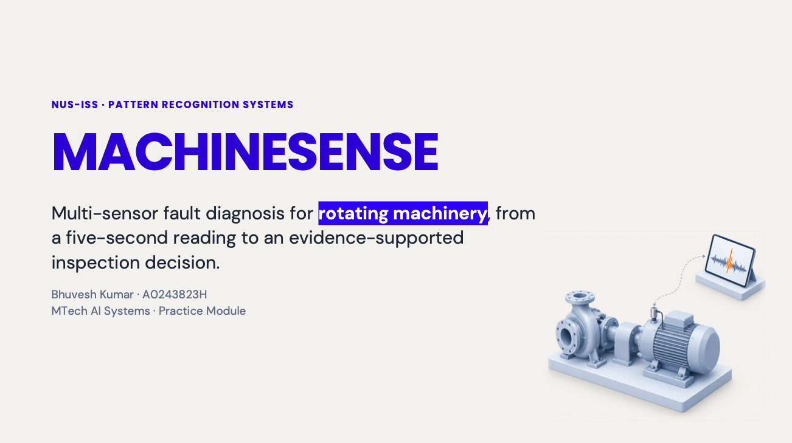
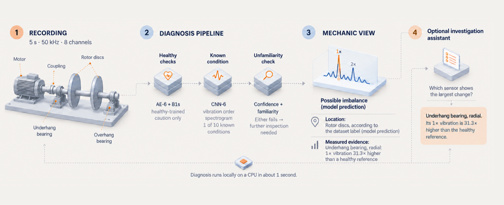

## SECTION 1 : PROJECT TITLE

  

## MachineSense: Multi-Sensor Fault Diagnosis for Rotating Machinery

NUS-ISS Pattern Recognition Systems (PRS) Practice Module, Group 01, Bhuvesh Kumar (A0243823H)

---

## SECTION 2 : EXECUTIVE SUMMARY

MachineSense analyses a five-second, eight-channel recording from the MAFAULDA test rig.
The channels are a tachometer, two three-axis accelerometers and a microphone.
It answers three questions.
Is the machine healthy (Q1)?
Which of ten known conditions does the recording resemble (Q2)?
Could it be a fault the models have not seen (Q3)?

A web app shows the result and its evidence in a Mechanic view and a Developer view.
An optional investigation assistant runs on a local language model.
It is a ReAct agent with read-only tools, and code checks every answer against the case record before it is shown.
It answers follow-up questions about a diagnosis.

The main contribution is a careful evaluation.
Recordings were split before any windows were made.
Development folds were grouped by folder.
The reserved tests were opened once, after the models, thresholds and decision rule were frozen.

Results on the sealed tests:
- **Q2:** ten-class macro-F1 0.916 (95 % interval 0.845 to 0.972) on 290 recordings.
- **Q3:** 925 of 1,123 unfamiliar-fault recordings (82.4 %) were sent for further inspection.
- **Q1:** no fault recording was called healthy. But 5 of 7 and 19 of 20 healthy recordings were also not called plainly healthy.

A diagnosis runs on a CPU in about one second.
MachineSense is a research demonstration. It is not validated on real machines.

  

---

## SECTION 3 : PROJECT CONTRIBUTION

| Official Full Name | Student ID | Work Items (Who Did What) | Email |
| --- | --- | --- | --- |
| Bhuvesh Kumar | A0243823H | Problem framing and evaluation protocol; data audit, splits and pipeline; physics features and order spectrograms; CNN-6, healthy-only detectors (AE-6, B1s) and open-set checks; decision rule; research stages R0 to R10; FastAPI backend and React app; explanation layer and investigation assistant; D7 and App-9 evaluations; report, slides and video | [bhuvesh@u.nus.edu](mailto:bhuvesh@u.nus.edu) |

This is an individual project. AI tools were used as assistants, as described in the report's "Use of AI tools" section.

---

## SECTION 4 : VIDEO AND SLIDES OF SYSTEM MODELLING & USE CASE DEMO

**Video:** [Video/PRS-PM-2026-10-31-GRP-01_Bhuvesh_Kumar_A0243823H_Video.mp4](Video/PRS-PM-2026-10-31-GRP-01_Bhuvesh_Kumar_A0243823H_Video.mp4) (14 min 27 s, 1080p)

### Slides

- **First presentation (6 Oct 2026):** [Slides/PRS-PM-2026-10-31-GRP-01_Bhuvesh_Kumar_A0243823H_Slides_1_Proposal.pptx](Slides/PRS-PM-2026-10-31-GRP-01_Bhuvesh_Kumar_A0243823H_Slides_1_Proposal.pptx)
- **Final presentation:** [Slides/PRS-PM-2026-10-31-GRP-01_Bhuvesh_Kumar_A0243823H_Slides_2_Final.pptx](Slides/PRS-PM-2026-10-31-GRP-01_Bhuvesh_Kumar_A0243823H_Slides_2_Final.pptx)

---

## SECTION 5 : USER GUIDE

`Refer to appendix <Installation and User Guide> in project report at Github Folder: ProjectReport`

- **Standalone installation and user guide (PDF):** [UserGuide/PRS-PM-2026-10-31-GRP-01_Bhuvesh_Kumar_A0243823H_UserGuide.pdf](UserGuide/PRS-PM-2026-10-31-GRP-01_Bhuvesh_Kumar_A0243823H_UserGuide.pdf)
- The same content is the "Installation and User Guide" appendix of the report in [ProjectReport/](ProjectReport/).
- Full run instructions are in [SystemCode/HOW_TO_RUN.md](SystemCode/HOW_TO_RUN.md).

Quick start, in brief (you do not need the MAFAULDA dataset):
1. **Clone:** `git clone https://github.com/bhuveshsharma09/MachineSense.git`
2. **Install:** in `MachineSense/SystemCode`, create a Python 3.12 venv, then run `pip install -r requirements.txt` and `pip install -e .`
3. **Start the backend:** `uvicorn backend.app:create_app --factory --host 127.0.0.1 --port 8000`
4. **Start the frontend:** in `SystemCode/frontend`, run `npm ci` and `npm run dev` (Node 22)
5. **Open** http://localhost:5173

No login is needed. The app asks only for a display name, kept in your browser.
Choose **Start investigation** and pick one of the 5 demo recordings:

| Recording | Verdict the app shows |
| --- | --- |
| `normal__24.576` | healthy |
| `imbalance__30g__19.456` | known fault: imbalance |
| `horizontal-misalignment__1.0mm__24.9856` | known fault: horizontal misalignment |
| `underhang__cage_fault__6g__35.0208` | known fault: underhang cage (see the envelope view) |
| `imbalance__10g__13.9264` | further inspection needed |

The demo recordings are development recordings, not test data.

---

## SECTION 6 : PROJECT REPORT

`Refer to project report at Github Folder: ProjectReport`

**Report:** [ProjectReport/PRS-PM-2026-10-31-GRP-01_Bhuvesh_Kumar_A0243823H_Report.pdf](ProjectReport/PRS-PM-2026-10-31-GRP-01_Bhuvesh_Kumar_A0243823H_Report.pdf)

---

## SECTION 7 : MISCELLANEOUS

`Refer to Github Folder: Miscellaneous`

- **[Miscellaneous/images/](Miscellaneous/images/)**: screenshots and figures used in the report and slides.

### Datasets

- **Source:** MAFAULDA (Machinery Fault Database), Federal University of Rio de Janeiro (UFRJ). Kaggle copy used here: [mafaulda-full](https://www.kaggle.com/datasets/vuxuancu/mafaulda-full).
- **Size:** 1,951 recordings, each 5 s at 50 kHz on 8 channels (tachometer, two three-axis accelerometers, microphone). The download is about 13 GB (31 GB as CSV files), so the full dataset is not included in this repository.
- **Included instead** (enough to run the system):
  - [SystemCode/metadata.csv](SystemCode/metadata.csv): the full index, one row per recording, with its labels, measured shaft speed and every split assignment (closed set, severity, speed block and the nine leave-one-class-out columns). The split hash computed from it (`4a935793…`, by `ml.splits.split_hash`) is recorded in the bundle manifest.
  - [SystemCode/demo/](SystemCode/demo/): the demo pack, 5 development recordings plus the 4 healthy reference recordings they are compared with. No test recording is included.
- **Reproduce with the full data:** download the Kaggle copy and follow "Full reproduction" in [SystemCode/HOW_TO_RUN.md](SystemCode/HOW_TO_RUN.md#full-reproduction-optional-needs-mafaulda).

**This Pattern Recognition Systems (PRS) Practice Module is part of the NUS-ISS MTech in Artificial Intelligence Systems.**
